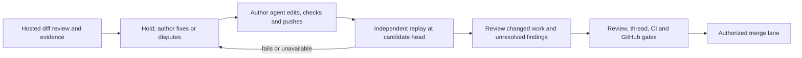

# Hosted analysis, review changes by the author

Status: proposal; no runtime changes. Reconciled on 2026-11-13 with main at
[`ac77839088a44af9d83e8182bd711f3a99eb87a0`](https://github.com/agent-labs-dev/mergeloop/commit/ac77839088a44af9d83e8182bd711f3a99eb87a0).
This shipped baseline replaces the historical November 7 inventory. Proposed settings,
tools and gates are explicitly marked; describing them does not make them available.

## Decision and shipped baseline

Keep sandboxed review, security analysis, experiments, evidence replay and merge gates hosted.
Jonas's November 7 decision is already implemented: review findings go back to the author,
never to a MergeLoop review fixer. Auto-fix and `fix_ci`'s budget apply only to red CI.
Read-only review may write disposable diagnostic files and publish findings; it does not
publish corrective code. Conflict resolution remains a separate hosted task.

The first review reads the PR diff and surrounding code. After findings are sent back, later
rounds read new commits plus those findings and author replies. A rebase or base merge resets
that comparison to the whole PR diff when another review is needed. Approval reuse is distinct:
a clean queue rebase, or a stack layer whose own diff is unchanged, can retain its approval
without another review. Do not invalidate every review merely because SHAs moved.

| Surface | Shipped behavior at this baseline | Remaining proposal |
| --- | --- | --- |
| Execution settings | Review, CI-fix and conflict work is hosted. `agent.runs` was removed; a file still setting it fails to parse and stops the repo's queue. | An opt-in author-publication policy below, with no local review mode or revival of `agent.runs`. |
| Stack visibility | Queue shows each layer's title, checks, diff and blocker, and collapses runs of similar layers in long stacks. | Add readiness, ownership and evidence provenance to these rows; do not rebuild shipped stack UI. |
| Stack reviews | Each layer is reviewed against the layer below. An approved layer whose own diff is unchanged after a lower-layer fix keeps its approval. | Preserve reuse and show original assessment versus carried coverage. Changed layer behavior still needs review. |
| GitHub approval | Once review no longer holds a PR and its review comments are resolved, MergeLoop approves on GitHub. Newly posted comments must be resolved too. Approval can satisfy required reviews unless rules require a human; stale approvals are renewed once coverage is established for the new head. The App never approves a PR it opened. | Preserve the default. Strict publication ownership would change this in the opt-in policy and needs the decision below. |
| PR interface | Dashboard is a queue view. Rows open GitHub for description, diff, discussion and replies. You, in-app PR detail and the unqueued-PR list were removed. GitHub labels and API/MCP/CLI queue PRs. | Improve queue and agent-rendered views without claiming removed pages or APIs exist. An in-app PR manager is a separate decision. |
| Deep evidence | Deep still permits panel agreement to support a non-security change without a replayed failure. Security and human exceptions remain explicit. | [Draft #306](https://github.com/agent-labs-dev/mergeloop/pull/306) removes the non-security exception. It is unshipped and narrower than the correction-replay and prevention requirements below. |

Source contracts: [hosted execution](../content/changelog/2026-11-07-agent-runs-local-is-gone.md),
[incremental reviews](../content/changelog/2026-11-06-rereview-reads-only-new-commits.md),
[GitHub inbox](../content/changelog/2026-11-10-github-is-your-inbox.md),
[GitHub PR pages](../content/changelog/2026-11-10-prs-open-on-github.md),
[stack visibility](../content/changelog/2026-11-11-see-each-pr-of-a-stack.md),
[unchanged-layer approvals](../content/changelog/2026-11-11-stack-layers-keep-their-review.md),
[GitHub approvals](../content/changelog/2026-11-12-mergeloop-approves-on-github.md) and
[waiting for comments](../content/changelog/2026-11-12-no-approval-beside-open-comments.md).

## Feedback and decisions still needed

Furqan's November 6 feedback asks for hosted analysis, fixing through his own agent, visibility
and an agent polling MergeLoop directly. His follow-up says he cannot control what MergeLoop
puts in. The unavailable screenshot establishes no additional facts. His November 7 message
asks for agent-maintained readiness, PR context, discussion, merge control and a list without
more pages; his agent can render that list in chat.

Those goals remain relevant, but earlier design choices now conflict with shipped behavior:

- **Author ownership is a new opt-in policy.** Main deliberately removed local runs and hosts
  CI fixes and conflicts. Author-owned CI/conflict publication is not an existing mode.
- **GitHub is the PR interface.** Start with queue rows, GitHub links and agent reads. An
  unqueued/draft PR manager, inline discussion or dashboard Merge button would reverse the
  November 10 simplification. They remain product choices outside the first slice. Assessment
  before queueing also needs an explicit execution action; status reads alone prove no review.
- **Strict publication changes automatic GitHub reviews and approvals.** The owner-control
  requirement includes comments, review requests, thread resolutions and approvals, not only
  commits. Under that strict opt-in boundary, the user's agent applies accepted writes. It
  cannot retain automatic App approvals unchanged. Jonas must choose that boundary or explicitly
  authorize a hosted review/status publication exception. No exception is inferred here. A user's
  agent cannot supply required independent/human approval by approving its author's own PR.
- **Head-bound merge consent is stronger than today's queue delegation.** Queueing currently
  allows normal preparation and subsequent author pushes under the queue request. The proposed
  control requires renewed consent for changed content or stack scope. Diff-equivalent review
  coverage can carry, but cannot authorize a different commit for that control.
- **Correction replay and recurring prevention add gates.** Main can clear findings after thread
  resolution or a later review. Requiring independent correction replay and a retained prevention
  check is additional policy, not shipped behavior or all of #306.

This update records these choices without implementing or silently deciding them. Default hosted
behavior stays as shipped. Deep's non-security vote exception is an intentional policy change in
#306, rather than a conflict with stack visibility or GitHub approvals.

## Current implementation seams

The Rust crates retain their `mergepatrol` names. Hosted means a service job sandbox;
`LocalExecutor` in [executor](../crates/executor/src/lib.rs) is a development subprocess executor,
not an author-run review setting.

| Responsibility | Current source and reuse boundary |
| --- | --- |
| Review and author handoff | [review.rs](../crates/mergepatrol/src/review.rs) schedules hosted review and publishes findings. Findings hold for the author; do not recreate removed `FixReview`. |
| CI and conflicts | [prep.rs](../crates/mergepatrol/src/queue/prep.rs), [queue.rs](../crates/mergepatrol/src/queue.rs) and [job.rs](../crates/mergepatrol/src/job.rs) dispatch prep/lane work. `FixChecks` is for red CI. Default `fix_ci.attempts` is three; conflicts are separate. |
| Verify commands | `job::checks_for` uses configured `verify`, or [core/ci.rs](../crates/core/src/ci.rs)'s workflow derivation at the PR head. Reuse that parser. Derived commands guide agents; configured commands gate a resolution/fix, separately from required GitHub checks. |
| Evidence | `job::check_evidence` resets to the reviewed head, applies only named evidence files and records command, patch and output. Timeouts and exit 126/127 do not qualify. Protected/outside-checkout files are refused. [core/review.rs](../crates/core/src/review.rs) owns routing; [resolver](../crates/resolver/src/lib.rs) owns instructions. |
| Approval coverage | [store/review.rs](../crates/store/src/review.rs)'s `diff_id`, `carry_unchanged`, `carry_review` and `review_queue_change` distinguish unchanged coverage from edits needing review. Reuse the producer's per-layer comparison, not a client approximation. |
| Gates | [web/gate.rs](../crates/web/src/gate.rs), review state, required checks, threads and the lane's final head checks govern merging. [queue-flow.md](queue-flow.md) documents prep/lane behavior. Neither readiness nor GitHub approval bypasses another gate. |
| Reads and actions | [routes.rs](../crates/web/src/routes.rs) registers `list_queue`, `pull_status`, `get_agent_review`, `next_need`, `list_events`, `queue_pull` and `dequeue_pull`. Removed inbox, PR-detail, local-review-submission and in-app answer routes are not integration seams. Discussion/replies are on GitHub with `gh`. |
| Polling | [need.rs](../crates/web/src/need.rs)'s `NeedView` has `needs`, `id`, `layer`, `brief`, `then`, `exit_code` and `status`. Its endpoint supports `after` and up to 50 seconds of long polling. [CLI](../crates/cli/src/main.rs) uses these tools; it starts no author agent. |

## Deep review: demonstrate behavior and retain prevention

This is independent of the optional publication split. Main's `Depth::votes_on` and
`Finding::shows_the_change` still permit Deep's non-security panel fallback. #306 proposes
Standard's independent evidence requirement at every depth, retaining three Deep reviewers,
security panels, confidence bars and human exceptions. It does not implement all of this section.

1. **Run the behavior.** Spend Deep's extra effort on user flows, failure injection, property
   checks and deterministic static/formal checks. Non-security author-change findings need a
   command MergeLoop independently runs on the reviewed head and sees fail for that defect.
   Majority/unanimous agreement and stored votes cannot replace proof. Formal results record
   the model, assumptions and bounds, not a claim of whole-system verification.
2. **Keep provenance.** Identify review ID, comparison base, reviewed SHA, setup/command, evidence
   patch, expected violation, observed exit/output and limits. Missing proof leaves a non-blocking
   note. Timeout, absent tools or setup failure is incomplete execution and cannot clear an
   existing supported finding. Label security/human exceptions and rationale; votes are not
   executable verification.
3. **Replay corrections independently.** Preserve original evidence and run it against the
   author's candidate head, recording offending and candidate SHAs. An author report or new vote
   cannot substitute. An earlier passing run is not execution at a new SHA. Coexist with
   unchanged-layer approval reuse: show carried coverage separately from current execution,
   and revalidate changed work and unresolved findings.
4. **Retain prevention for recurring accepted mistakes.** Link the earlier finding or owner rule.
   Keep a regression check, lint/type rule, property test or deterministic architecture constraint
   in normal CI; reuse existing sufficient protection. Record command/path and proof it fails on
   the offending SHA and passes on the correction. Disposable evidence alone is insufficient.
   The user's agent applies proposed checks through the owner flow; pending/rejected/stale
   suggestions cannot clear findings.

Acceptance includes unproven majority/unanimous findings staying notes, reproduced defects reaching
authors without hosted fixes, formal bounds, stale/unavailable replay never clearing a supported
finding, and independently proven retained prevention. Extend existing routing/job scenarios when
implementing; this design adds no runtime tests.

## Proposed author-publication policy

### Settings and dispatch

Use one proposed typed publication policy on existing `AgentSettings`, with tentative YAML
`agent.edits: hosted | author`. Both values run hosted reviews. `hosted` preserves today's default;
opt-in `author` hands CI edits, conflicts and PR-content writes to the user's agent. This is a new,
unimplemented field, not valid current configuration. `agent.runs` stays rejected; do not restore
`Runs`, `local` or `hosted-review` run values, or author-submitted reviews.

| Proposed value | Review | Review findings | Red CI | Conflicts / branch updates |
| --- | --- | --- | --- | --- |
| `hosted` (default) | Hosted | Hold for author | Hosted when `fix_ci` enables it | Current hosted prep |
| `author` (opt-in) | Hosted | Hold for author | Author's agent; no hosted attempts consumed | Author's agent, including clean rebases/restacks |

Route exhaustively at dispatch and publication with the existing task model, not a second
scheduler. Enforce it in prep and lane, including `MERGEPATROL_PREP=false`. Author ownership cannot
depend on prep, lease expiry or a missing key. Hosted analysis still needs its key and a visible
missing-key hold; never fall back to author review or skip explicitly requested analysis. Findings
cannot become `FixChecks`. Policy changes cancel obsolete jobs and reject their publication.

Round-trip the new field through parsing/writing/inheritance in
[repo_config.rs](../crates/core/src/repo_config.rs), `RepoSettingsView` in
[web/api.rs](../crates/web/src/api.rs), generated `ui/src/api`, [RepoSettings](../ui/src/RepoSettings.tsx)
and `get_repo_config`, `propose_repo_config`, `get_repo_defaults`, `set_repo_defaults`.
Keep defaults and fork restrictions; grant no new GitHub or model credentials.

### Owner-visible proposals

In the strict opt-in variant, hosted jobs may read, experiment, persist findings/validation and
prepare disposable integration work, but cannot publish generated code or PR content. Every
source/test/docs/config edit, rebase/restack, empty commit, retitle/body change, comment, review,
approval, reviewer request or thread resolution carries a stable proposal ID/revision, repo/PR/layer,
target SHA, originating review, reason/evidence and exact diff/text. Including automatic App
reviews/approvals is deliberate; the decision section identifies the resulting product conflict.

Persist typed `pending | accepted | rejected | stale | applied` state. Acceptance records consent
for that revision/head, never a hosted publish. The user's agent applies it through its authorized
workflow; verify its commit/GitHub operation before showing `applied`. Changed target heads make
unapplied proposals stale and require refreshed content and consent. Rejection cannot clear a
finding, authorize merging or reissue the suggestion as new work. Heartbeats/leases are no consent.
Guard publication as well as dispatch, including comments, approvals, retitles and stack updates.

An explicitly authorized final merge may remain hosted behind normal gates with content the agent
applied. It cannot authorize extra generated edits or supply required review. Any automatic App
review/status exception must be explicit before implementation; pending proposals cannot count as
GitHub approvals or make a PR ready.

### Author handoff and correction validation

Extend `NeedView` with proposed reviewed/candidate heads, review ID, proposals and verify commands
with typed `configured | ci | none` source. Keep current need kinds and `id`/`after`/`wait`.
Removed `fix_checks` and `conflict` needs cannot be reused; introduce typed author-work holds/needs
where the new policy requires them in prep and lane. Scope finding IDs by review: `f1` starts again
in each. `get_agent_review` already returns evidence command, output and patch, but its latest
review may be of an older head. Present an authoritative snapshot with freshness explicit.

The author fixes/disputes GitHub threads and pushes through their workflow; proposal decisions
cannot settle the finding. Do not revive local-review or in-app answer tools. The next tick/webhook
discovers the push as today.

Propose a validation-only task in [protocol.rs](../crates/executor/src/protocol.rs), with
`returns_code` false, no bundle or fix commit. Reuse job evidence helpers. Replay original evidence
in a disposable checkout, using an intact retained patch or applying the original with
[Git::holds/apply](../crates/git/src/lib.rs); check integrity after commands. Conflicts, weakened
diagnostics, absent tools and timeouts need refreshed evidence or a human, never an inferred pass.
Run configured verify commands; keep workflow-derived advice advisory.

Persist validation keyed by `(review_id, reviewed_head, candidate_head)` in the review store with
a migration. Attach it to prior-finding context. Distinguish original execution, correction replay
and carried unchanged-diff coverage. Review changed work/unresolved findings when comparison is
valid; otherwise expose the full-diff reset. Security without runnable evidence still requires
hosted examination; human asks keep their gate.

Keep sandbox read-only fetch tokens, revocation and model proxies. Author agents receive no
`JobSpec` service credentials or hosted job access. Validation never publishes diagnostic files.

## Readiness and control through the queue and the user's agent

Extend shipped [Queue](../ui/src/Queue.tsx) layer rows and shared API/MCP projections. Keep GitHub
as the route to PR description, diff and discussion. Agent chat tables can combine these reads
with authorized GitHub reads. Do not recreate You, PullDetail, inbox tables or removed detail/reply
APIs as prerequisites. Propose any missing canonical backend read explicitly instead of claiming
a removed read exists or re-deriving backend state in each client.

Derive readiness server-side from review coverage/evidence, CI, draft, approvals, threads, conflicts
and stack gates. Show ready, blocked with next actor, checking or unknown/stale; never a score or
green-CI-only approval. Separate position from readiness. Return assessed/base/reviewed heads,
source, update time, blocker and carried coverage. On pushes refresh applicable gates while
preserving proven unchanged-layer coverage. Do not imply execution at the new SHA. Missing
required reads stay unknown.

Stack rows, checks, diffs, holds and GitHub links already exist. New value is shared readiness,
next actor and provenance. `next_need` shows required action, not proof an agent is connected.
Stored review `pending`/`running` and events show coarse hosted activity; buffered job events are
not live tool streams. A running review may await a sandbox slot. An author hold never means
their agent runs.

Unqueued/draft PRs found on GitHub stay unassessed unless actual coverage exists. Reading or
polling cannot queue them. Assess-only execution, an in-app manager and an owner Merge button
remain separate decisions. If scoped Merge is chosen, extend `queue_pull` with expected head and
stack scope; recheck caller permissions/gates server-side, reject stale submissions and invalidate
consent when authorized content changes. Show affected layers and queued/waiting/failed/verified
merged outcomes. Never bypass gates, publish drafts implicitly or infer consent from readiness.

## API/MCP and progress

[routes.rs](../crates/web/src/routes.rs) stays the route/tool registry; MCP calls the same handlers
as its authenticated caller. Use `next_need`'s long poll, not a daemon or subscription transport.
The CLI's landing command queues work; inspecting an unqueued PR uses reads. A `queue` need is
not user permission to queue.

| Surface | Proposed change |
| --- | --- |
| `list_queue`, `pull_status`, `get_agent_review`, `next_need`, `list_events` | Shared readiness, ownership, head/freshness/coverage provenance with compatible fields. No removed inbox/detail endpoints. |
| `next_need` | Poll with `after`, `wait: 50`; `threads` hands findings to author. New CI/conflict work needs typed additions. Decisions update needs; rejection/heartbeats do not create repeated work. The hashed `id` is no proposal ID, consent or proof of activity. |
| Proposed decision tool | `respond_to_agent_proposal` idempotently records accept/reject for ID/revision/head after repo authorization; it never publishes. |
| Optional scoped merge | Extend `queue_pull` only if chosen, with expected-head/scope checks and normal gates. |
| Proposed progress tools | `claim_agent_work`, `report_agent_work`, `release_agent_work` use fenced leases scoped to installation/repo/PR/layer/head, operation IDs, typed phases, monotonic fencing and expiry. Caller identity is server-derived; display labels are descriptive. |

Reuse [auth.rs](../crates/web/src/auth.rs)'s `Caller::repo` and `caller.github_token` conventions.
Require repo write access for editing claims/reports. Leases grant no credentials, approval or
merge authority. Invalidate on new head/policy, dequeue, retarget or stack reshape; old reports
cannot revive them. Verify reported pushes on GitHub. Expiry shows no recent report and keeps
author ownership, never starts a hosted fixer. Store separately from review-worker claims,
since work spans review, CI and conflicts. The agent reports its phase; the thin CLI cannot
observe it. Register routes with `tool!`, update README descriptions and regenerate API types.

## Delivery and acceptance

| Slice | Status / completion criterion |
| --- | --- |
| Polling and author review handoff | Shipped. No daemon, review-fixer removal or local-review feature remains to implement. |
| Stack rows and unchanged-layer review reuse | Shipped. Preserve them while adding queue/agent readiness and ownership provenance. |
| GitHub reviews and approvals | Shipped, including open-comment and App-authored safeguards. Preserve defaults; decide strict-policy publication exceptions explicitly. |
| Deep failing evidence | Draft #306, independent of the split. Shared evidence routing; retain security/human exceptions and three reviewers. |
| Correction replay / recurring prevention | Additional design, not all of #306. Demonstrate failures/corrections at named SHAs and retained protection while preserving legitimate carried coverage. |
| Author-publication policy | Needs Jonas's decision. Ship settings, proposal decisions/storage, prep/lane guards, publication guards and validation together; no `agent.runs` or local review. |
| Progress | After ownership, add durable fenced acknowledgement/phase/freshness; no invented presence. |
| PR manager, assess-only, scoped Merge UI | Separate product/authority choices against today's GitHub-first interface, not readiness/Deep prerequisites. |

Extend existing review routing, job, review-store and
[queue-loop scenarios](../crates/mergepatrol/src/queue/loop_tests/getting_ready.rs) at implementation:

- Findings hold for authors without corrective publication; only red CI uses `FixChecks` and
  default hosted attempts. Author-policy CI/conflicts stop for the author in prep and lane,
  including prep disabled. No removed review fixer returns.
- Lower-layer fixes preserve approval above only for unchanged layer diffs. Show each layer's
  checks, diff, blocker and original/carried provenance. Changed work needs review; no old command
  result is relabeled execution at a new SHA.
- GitHub approval waits for unresolved comments, including newly posted findings, follows current
  coverage/stale-approval rules, never approves the App's own PR or replaces required human review.
  Strict-policy changes to these writes are explicitly selected.
- Pending/rejected/stale proposals cause no publication. The user's agent applies accepted content;
  decisions cannot clear findings. Stale jobs/leases/validation cannot publish or clear a different
  head/policy. Defaults remain unchanged outside opt-in scope.
- Corrections pass original-evidence replay; weakened patches, conflicts, timeouts or missing tools
  cannot imply a pass. Incremental/full-diff resets and carried coverage stay distinct. Security
  and human routes remain explicit.
- UI/API/MCP agree on readiness/next actor. Heartbeats, green CI, missing reads and unassessed PRs
  cannot become ready. Reading never queues. Optional scoped Merge rejects stale head/scope or
  missing authority, respects drafts/gates and reports the verified outcome.

This is a design only. Runtime slices need validation and user-facing changelog entries.
Keep #260 open, draft, unqueued and unlabeled with auto-merge off; Jonas decides what to adopt.
